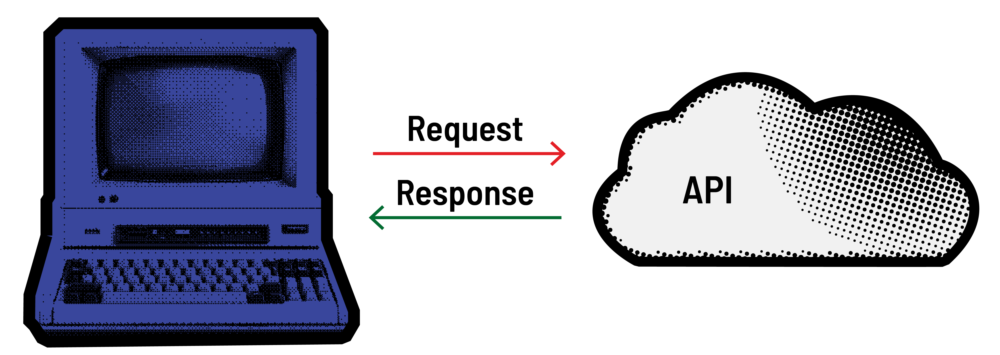

<h1>
  Server Development with Flask
  What is Flask?
</h1>

**Learning objective:** By the end of this lesson, students will be able to describe Flask and its role in creating and managing web servers.

| Lesson         | Duration |
| -------------- | -------- |
| What is Flask? | 10 min   |

## Our Learning Goals

- Use Flask to create an API server
- Describe the role of API servers in web development

## What Are APIs Made Of?

Before we dive into creating servers with Flask, it’s important to recap what makes an API effective and how Flask plays a role in that process.

APIs, or Application Programming Interfaces, are the backbone of how applications communicate. They allow programs to interact with each other by defining a set of rules for requests and responses.

### Key Characteristics of an Effective API

For an API to work effectively within a program, it needs to:

- **Accept User Requests**: APIs must be able to take in requests from users or other applications. In Flask, this is handled through routes that define specific endpoints where these requests are received.

- **Return Appropriate Responses**: After processing a request, the API must provide a meaningful response. Flask allows you to craft these responses, ensuring that the user or application receives the data or confirmation they need.

- **Parse and Handle User Input**: An API should be able to parse the details provided in a user’s request, such as query parameters or data submitted in forms. Flask’s routing system allows you to capture and use these details to generate accurate responses.

 

## The Web Development Ecosystem

In web development, technologies are generally divided into two categories:

- **Front-End:** This includes HTML, CSS, and JavaScript, which handle everything the user interacts with directly in the browser, such as layout, design, and interactivity.

- **Back-End:** This encompasses servers, databases, and the core application logic that operate behind the scenes, processing requests, managing data, and ensuring everything runs smoothly.

## Web Development with Flask

In modern web development, APIs play a central role in enabling applications to interact with users and other systems. Whether you're building a simple website or a complex web application, APIs are essential for handling user requests, processing data, and returning meaningful responses.

### Why Flask?

Flask is a powerful yet minimal Python library that makes it easy to create and manage web servers. It’s widely used in the industry because of its simplicity, flexibility, and ability to scale with your project’s needs. Whether you're just starting out or working on a large-scale application, Flask provides the tools you need to get the job done.

### What Can You Do with Flask?

- **Build Entire Back-End Systems in Python:** Flask allows you to write your entire server-side logic in Python, making it an excellent choice for developers who are already familiar with the language.

- **Handle Simple and Complex Tasks:** Flask is versatile enough to handle both small and large projects. You can use it to:

  - Create microservices or small APIs for specific tasks.

  - Stand up a simple web application, such as a personal blog.

  - Build and manage complex applications like Pinterest’s API or even create a full-featured social media platform similar to Twitter.

Flask’s minimalistic approach gives you the freedom to structure your application as you see fit, without unnecessary overhead. This makes it an ideal framework for both beginners and experienced developers who need a reliable and scalable solution for web development.
